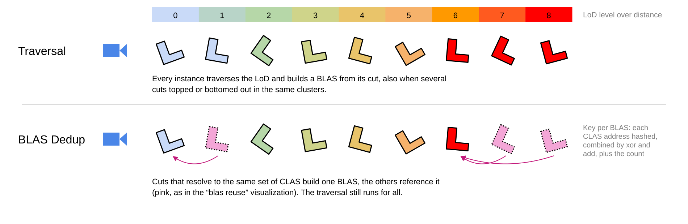

# BLAS Deduplication for ray tracing cluster-based continuous level of detail

**BLAS Deduplication** removes BLAS (Bottom Level Acceleration Structure) builds within a
single frame, by detecting that several instances ended up referencing the exact same set
of CLAS. Only one of them is built, the others point at its result.

## Motivation

Kit-bashed or procedurally placed props frequently either top out or bottom out in the
LoD DAG. As a result many instances of e.g. the same rock resolve to an identical cluster
set, despite each having traversed the LoD on its own.

The technique is enabled with the "Blas Dedup" checkbox or `--blasdedup 1`, it is off by
default. The hybrid renderer uses _"Hybrid blas dedup"_ (`--hybridblasdedup 1`, on by default) instead.

### Relation to the BLAS sharing family

It is **orthogonal** to ["BLAS Sharing"](blas_sharing.md),
["BLAS Caching"](blas_caching.md) and ["BLAS Merging"](blas_merging.md), and can be
combined with them.

Those techniques decide *up front*, from the LoD range classification of an instance,
which instances may re-use a BLAS, and thereby also avoid the LoD traversal work.
Deduplication instead acts *after the fact*: instances traverse the LoD as usual, and we
then notice that two of the resulting BLAS are identical. It therefore does not save
traversal work, but it catches cases the others cannot.

## Algorithm

Two BLAS are equivalent if they reference the same set of CLAS. To test that cheaply on
the device, each BLAS accumulates an order-invariant key from its clusters:

* Each referenced CLAS address is hashed with murmur3
  (`murmurHash3Combine` / `murmurHash3Finalize` in [shaderio_core.h](../shaders/shaderio_core.h)).
  There is exactly one CLAS per resident cluster, so within a frame the address identifies
  the cluster.
* The hashes are combined with both xor and add, and the number of CLAS is the third
  component. The resulting 96-bit key does not depend on the order of the reference list,
  which matters because the lists are filled by unordered atomics.
* The key is computed once the lists are complete. The lists are packed, so a subgroup of
  consecutive entries mostly belongs to one BLAS and adds its share with one atomic per
  key component. Folding the key in while inserting costs two more atomics per CLAS on
  the same few addresses, which doubled the insertion time.

The BLAS then insert themselves into a hash table, indexed by the lower bits of the
accumulated `xor`:

* On a successful insert the BLAS is unique and will be built.
* On a collision the full 96-bit key is compared against the BLAS that owns the bucket.
  If it matches, the BLAS is a duplicate and records that other BLAS as its
  representative.
* Otherwise a short linear probe tries the next buckets. If none of them works out, the
  BLAS conservatively marks itself as unique.

Not finding an equivalent BLAS is always safe, it only means we build a BLAS that we could
have re-used.

## Results and limitations

On 256 copies of one geometry with BLAS sharing disabled, deduplication takes 256 BLAS builds down to 17.

* It does not save traversal work, every instance still traverses its LoD.
* Equal keys are taken as equal sets, the CLAS lists are not compared. Two different sets match only if
  the xor and the sum of their 32-bit hashes and their counts agree.

### Statistics

The _"Blas settings"_ in the traversal settings and the sequencer report show:

* how many BLAS candidates existed and how many of them were deduplicated,
* the hash table probes, per candidate in the UI and as a total in the report,
* the number of candidates that ran out of probes.

The last two are worth watching on large scenes: a table that is too small, or a key that
distributes poorly, degrades into "everything is unique" rather than into a visible bug.
`BLAS_DEDUP_PROBE_COUNT` in [shaderio.h](../shaders/shaderio.h) sets the probe budget.

The "blas reuse" visualization colors deduplicated instances in pink, apart from the
green to red ramp of the other techniques as it is a different mechanism. The
representative is colored like the rest of its group, rather than red: which candidate
wins the race is arbitrary and changes every frame, so a red representative would just
flicker around the scene.

## Implementation

The BLAS build operation reads its descriptors from a contiguous array, so a duplicate
must not occupy a slot in it. The per-frame BLAS allocation is therefore split into
*candidates* and *builds*:

* [blas_setup_insertion.comp.glsl](../shaders/blas_setup_insertion.comp.glsl): each
  instance with clusters allocates a `BlasCandidateInfo` rather than a build slot. The
  struct holds the CLAS reference list, the key and the deduplication result.
  It is never read by the driver, so we can keep this state next to the reference list
  that the per-CLAS kernel touches anyway.
* [blas_clusters_insert.comp.glsl](../shaders/blas_clusters_insert.comp.glsl): inserts
  the CLAS into its candidate's reference list and records the candidate for that entry.
* [blas_dedup_keys.comp.glsl](../shaders/blas_dedup_keys.comp.glsl): one thread per list
  entry hashes the CLAS address into its candidate's key.
* [blas_dedup_scan.comp.glsl](../shaders/blas_dedup_scan.comp.glsl): one thread per
  candidate performs the hash table insert and probe. Unique candidates allocate the
  actual build and copy their descriptor into the compacted `blasBuildInfos` array,
  duplicates only store their representative.
* [instance_assign_blas.comp.glsl](../shaders/instance_assign_blas.comp.glsl): resolves
  candidate to representative to built BLAS when writing the TLAS instance. Like sharing,
  a deduplicated candidate must not add to the memory statistics twice.

The deduplication pass runs before the cached BLAS builds, so those still allocate their
build slots directly in the compacted array and need no changes.

The hash table lives in its own buffer and is cleared with a fill operation at the start
of the frame. An entry stores `candidateIndex + 1`, so zero means "empty bucket".

## Acknowledgements

Thanks to Evan Hart, the deduplication algorithm originates from him.
