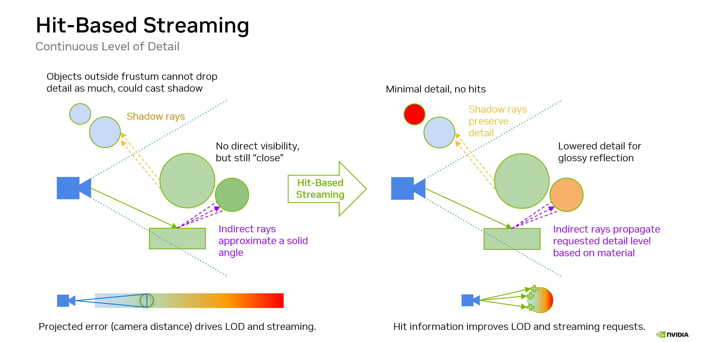
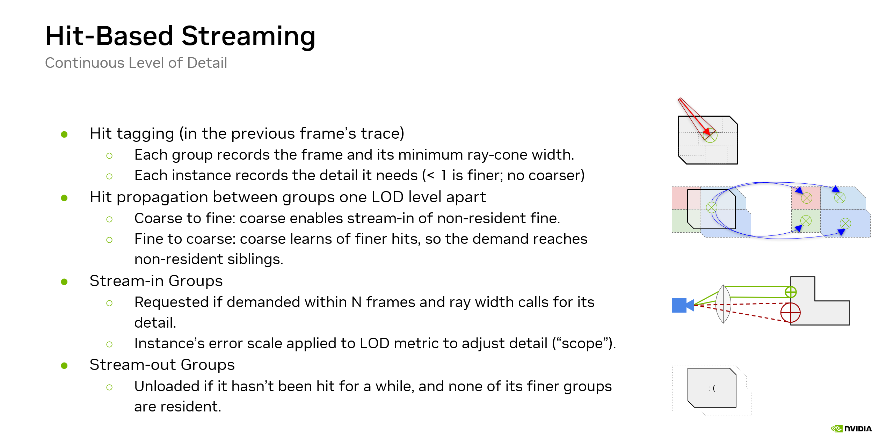
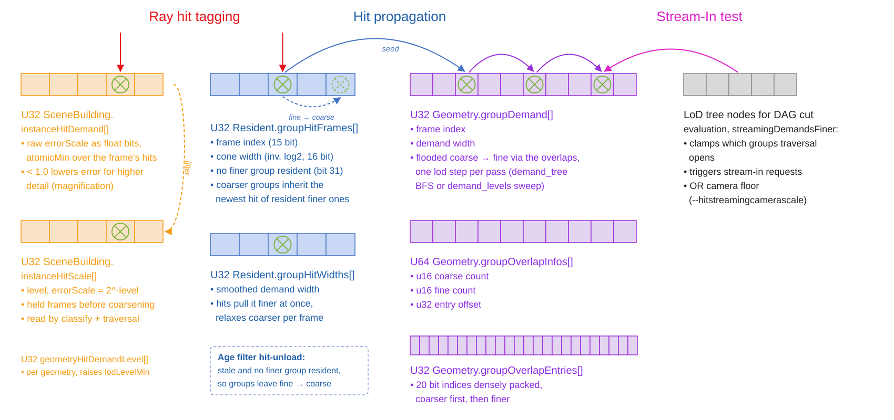

# Hit-based Streaming for ray tracing cluster-based continuous level of detail

Rasterization only streams in what survives its occlusion culling. Ray tracing cannot use that test, because shadow,
ambient occlusion and reflection rays reach geometry outside the primary view. **Hit-based streaming** replaces the
visibility prediction with feedback: it records which resident cluster groups rays actually hit, and uses that to
decide what is loaded, what is unloaded and, optionally, which level of detail is rendered.

It is ray tracing only and enabled with _"Hit streaming"_ in the _"Streaming"_ section (`--hitstreaming 1`, off by
default). The details are in the _"Hit settings"_ tree below it.

## Motivation

The regular [streaming](streaming.md) requests every group the LoD traversal wants. For ray tracing that traversal
only knows the camera distance, frustum and occlusion merely scale an instance's error heuristically. Everything in
reach of the camera metric is loaded, whether a ray ever gets there or not, and a wide-angle reflection of a distant
object is traced against the same detail as the object seen up close.

Rays tell us both things directly: which surfaces were reached, and how wide the ray footprint was when it got there.

All hit data except the per-instance scale [below](#finer-than-the-camera) is kept per geometry, as residency is
shared by all instances of a geometry anyway.

## Algorithm

### Recording hits

Every resident group has one `uint32` in `groupHitFrames` that the closest-hit shaders update with a single
`atomicMax`, a plain store without the [LoD adjustment](#lod-adjustment):

* bit 31: no finer group of this one is resident (inverted, set means none)
* bits 30..16: the frame of the last hit, as a cyclic 15 bit counter
* bits 15..0: the ray cone width at the hit, as an inverted `log2` so that the newest frame and within a frame the
  narrowest cone wins

Sun shadow rays register their hits up to a path depth, _"Shadow hit depth"_ (`--hitstreamingshadowdepth`). 1, the
default, registers them from the primary hits, all the ray tracer has, 2 also from the first bounce. They then run a
minimal closest-hit shader (the path tracer runs its own) instead of skipping it. Ambient occlusion and sky samples
register nothing, their random directions would keep far groups resident. With the default single bounce, over not
registering them, depth 1 costs the path tracer up to 0.03 ms per frame in the scenes below and depth 2 up to 0.08 ms.
Both keep up to 2% more groups resident.
Any-hit shaders register nothing, a candidate may not be kept. All age tests compare cyclic deltas, a once per frame
pass rewrites stale entries around the counter's wrap. The demand descent only rewrites the groups it visits, so it
clears the demand of a slice of geometries per frame, each one within 8192 frames.

### Hit propagation

Rays only hit the LoD cut that is rendered, never the coarser groups above it, which still have to stay resident.
`stream_hit_propagation.comp.glsl` therefore runs over all resident groups once per frame and lets each group inherit
the newest hit of its resident finer groups, one LoD transition per frame. It also maintains the "no finer group
resident" bit.

### Stream-in

A non-resident group is only requested when the surface it covers was hit recently. The scene processing stores, per
group, which groups one level coarser and one level finer overlap it (`Scene::buildGeometryLodOverlap`, 20 bit
indices). The table is persistent per geometry, because a group needs it before it is resident.

A per-frame demand pass floods the hit signal from the resident groups into `Geometry::groupDemand` of the finer,
non-resident ones. The traversal then tests a single value per group (`streamingTestOverlapHits` in
[`streaming.glsl`](../shaders/streaming.glsl)). How far the flood reaches in one frame depends on the
[propagation mode](#propagation-modes).

Loads should arrive coarse to fine, see the limitations. A cluster whose finer group is not resident is rendered as the finest
available version of its surface, so loading a fine group without the levels between would render the same surface
twice.

### Stream-out

On top of the regular age based unload, a group is unloaded when its last hit is older than the age threshold plus
32 frames (`--streamingagethreshold`, 16 by default) and no finer group is resident, so unloads also go fine to
coarse. Without that order, unloading a level in the middle would cut the coarser groups off from the inherited hit
signal, and they would follow even though the surface is still being hit. With the LoD adjustment, groups the
traversal still opens are kept as well.

### LoD adjustment

_"LoD adjustment"_ (`--hitstreaminglod 1`, on by default) uses the recorded cone widths to also limit the detail.
It follows the ray cone framework of
["Texture Level of Detail Strategies for Real-Time Ray Tracing" (Akenine-Möller et al., Ray Tracing Gems)](https://link.springer.com/chapter/10.1007/978-1-4842-4427-2_20):
a ray carries a cone of width `w0` at its origin and spread `α`, its footprint at distance `t` is `w0 + α·t`.

* **Primary rays** start with `w0 = 0` and the spread of the LoD metric itself, so the width they record equals the
  error the camera metric accepts at that group. With only primary rays the cut stays the camera metric's cut.
  The width is evaluated at the group's bounding sphere, as the metric is, not at the hit point.
* **Planar mirrors** keep the spread and add the distance, so a reflection always demands coarser or equal detail.
* **Curved mirrors** widen the spread by the curvature, a convex sphere demands distinctly coarser detail.
* **Shadow rays** continue the cone of the surface they start from.

The traversal opens a group only while the camera metric wants it **and** a recent hit demanded finer detail than the
group provides (`streamingDemandsFiner`, scaled by _"LoD width factor"_, `--hitstreaminglodfactor`). The same test is
applied to the group node and to the generating group of each cluster, so both decisions of the cut agree. A group
below the rendered cut is never hit itself, it reads the demand that was flooded into it.

* The demand tests read a smoothed width (`groupHitWidths`) rather than the last frame's hits. Hits pull it finer at
  once, it relaxes back by roughly one LoD level per 16 frames. Otherwise a single frame without the finest hits, from
  DLSS jitter or brief occlusion, would flip the cut back and forth.
* The finest level any ray demands is also recorded per geometry (`geometryHitDemandLevel`), and the instance
  classification uses it as the instance's finest level. Otherwise an instance that no ray demands detail for would
  keep traversing into an empty BLAS.

### Finer than the camera

A magnifier or a focusing mirror can demand more detail than the camera metric would ever open, for one instance
only. Each hit registers the ratio of its cone width to the camera's acceptable width in
`SceneBuilding::instanceHitDemand`, finer only, as an `atomicMin` over the frame.
`instance_hit_scale.comp.glsl` quantizes it into a per-instance error scale, applied at once and relaxed one level
per 32 frames. Traversal and classification combine it with `min()`, so it also overrides the coarser error scale of
an instance that is only seen in the mirror. The magnifier lens (`--opticalmode 3`, `--lenszoom`) demonstrates it,
below a magnification of 2 nothing changes.

### Camera floor

After a fast camera turn, regions no ray reached yet stay at the coarsest level until hits arrive and the levels
stream in one after another. _"LoD camera floor"_ (`--hitstreamingcamerascale K`, 0 by default, off) also opens a group
while the camera metric at `K` times the error wants it. On a camera path of fast turns `K = 2` halved the pixels
not yet at their final detail after a turn and cut loads by about 30%.

### Propagation modes

_"Propagation"_ (`--streampropagation`) selects how the demand pass floods `groupDemand`. All modes are consumed the
same way, they differ in reach and cost:

| mode | reach per frame | cost |
| --- | --- | --- |
| 0, resident levels | one level per streaming round trip | cheapest |
| 1, resident subtree (default) | every demanded level | proportional to the demanded subtrees |
| 2, all levels | every demanded level | one pass over all groups per LoD level |
| 3, all levels rolling | the coarsest `--streamrollingcoarse` levels (4 by default) in full, one finer level per frame | between 0 and 2 |

* _Resident subtree_ is a breadth-first descent from the hit groups along the finer overlaps, one LoD level per pass.
  A demand stays valid for 32 frames, so a subtree is only walked again once half of that has passed, or when a finer
  width arrives. _"Persistent demand"_ (`--persistenthitdemand 1`, on by default) drains it in a single dispatch.
* _All levels_ sweeps every group once per frame, coarse to fine, and writes zero where there is no demand. Demand therefore drops in
  one frame once its hits leave the 32 frame window, while the descent lets it age out level by level.
* _Resident levels_ settles about one level coarser than the other modes in places (4-5% of the pixels).

Filling a static view took 42 frames with resident levels against 6 with the other modes on the bunny.

## Results and limitations

Measured with the path tracer on an NVIDIA RTX PRO 5000 Blackwell with clocks locked, without DLSS,
from a static view with each scene's settings. Each configuration starts from a streaming reset and is averaged over the last 128 of 250
frames, three repetitions interleaved within one process. Hit streaming off / on:

| | Caldera | junkworld | Zorah |
| --- | --- | --- | --- |
| resident groups | 41015 / 38168 | 15960 / 12179 | 18354 / 10963 |
| geometry memory (MiB) | 95 / 86 | 139 / 110 | 593 / 408 |
| frame (us) | 6193 / 6424 | 3797 / 4014 | 5609 / 5884 |
| _"Stream"_ sections (us) | 16 / 113 | 18 / 47 | 20 / 246 |
| _"Hit Propagation"_ + _"Hit Demand"_ (us) | - / 117 | - / 141 | - / 189 |
| frames changing residency, of 128 | 0 / 98 | 7 / 36 | 0 / 128 |

* Residency drops by 7-40%. The savings come from the LoD adjustment: without it (`--hitstreaminglod 0`) residency
  is the same as with hit streaming off, and the frame is slower than without hit streaming in all three scenes.
* The frame gets 0.22-0.28 ms slower. _"Hit Propagation"_ and _"Hit Demand"_ take 0.12-0.19 ms, and the path tracer never
  lets residency settle: its random bounces keep moving the demand between groups, so groups are loaded and unloaded
  on most frames in Caldera and Zorah, about a quarter of them in junkworld.
* Feedback lags by a frame plus a streaming round trip. Disoccluded regions start coarse until they are hit, see the
  camera floor.
* Loads are not ordered coarse to fine yet. When a whole chain is requested at once and an intermediate level
  arrives late, the surface can render twice for a frame or two.
* The per geometry hit data means the most demanding instance sets the detail for all instances of a geometry,
  including those using a shared BLAS.
* The overlap links address 2^20 groups per geometry. A geometry with more gets none and streams by the camera.

## Implementation

In the source look for `USE_HIT_STREAMING`, `USE_HIT_STREAMING_LOD` and `STREAM_PROPAGATION_MODE`.

Key changes are:

* [`streaming.glsl`](../shaders/streaming.glsl): hit registration (`streamingRegisterHit`,
  `streamingRegisterHitLod`, `streamingRegisterInstanceDemand`), the stream-in tests `streamingTestOverlapHits` and
  `streamingDemandsFiner`, and the hit-based unload in `streamingAgeFilter`.
* [`render_raytrace_clusters.rchit.glsl`](../shaders/render_raytrace_clusters.rchit.glsl),
  [`render_raytrace_clusters_ao.rchit.glsl`](../shaders/render_raytrace_clusters_ao.rchit.glsl) and
  [`render_pathtrace_clusters.rchit.glsl`](../shaders/render_pathtrace_clusters.rchit.glsl): register the hits, the
  ray generation shaders carry the cone through the payload.
* [`stream_hit_propagation.comp.glsl`](../shaders/stream_hit_propagation.comp.glsl): inherits the hits fine to
  coarse, smooths the widths, records `geometryHitDemandLevel` and seeds the demand pass.
* [`stream_hit_demand_tree.comp.glsl`](../shaders/stream_hit_demand_tree.comp.glsl): the breadth-first demand descent
  of the resident modes, [`stream_hit_demand_levels.comp.glsl`](../shaders/stream_hit_demand_levels.comp.glsl): the
  level-wise sweep of the all levels modes.
* [`instance_hit_scale.comp.glsl`](../shaders/instance_hit_scale.comp.glsl): filters the per-instance demand.
* [`traversal_run.comp.glsl`](../shaders/traversal_run.comp.glsl),
  [`traversal_run_groups.comp.glsl`](../shaders/traversal_run_groups.comp.glsl) and
  [`instance_classify_lod.comp.glsl`](../shaders/instance_classify_lod.comp.glsl): apply the demand to the cut.
* [`stream_update_scene.comp.glsl`](../shaders/stream_update_scene.comp.glsl): seeds freshly loaded groups as hit
  this frame with the least demand, their region's demand comes from the coarser groups until they are hit.
* `Scene::buildGeometryLodOverlap` in [`scene_cluster_lod.cpp`](../src/scene_cluster_lod.cpp): the overlap tables,
  part of the scene cache file.

## Acknowledgements

Thanks to Jan Schmid (detail adjustment based on ray cones) and Christian Rouet (hit overlap propagation) for
their help.
