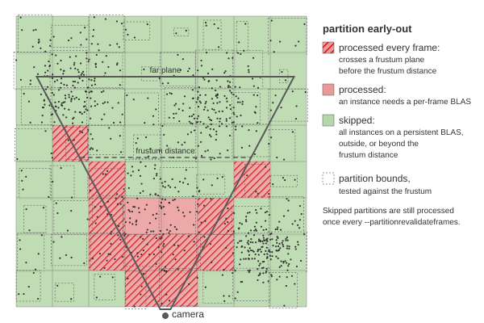
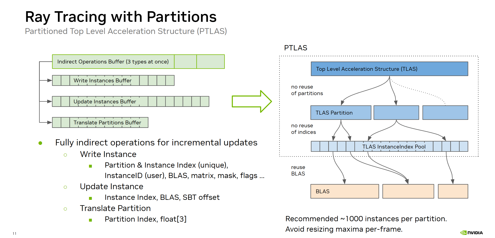
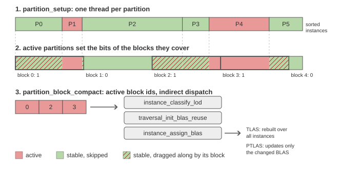
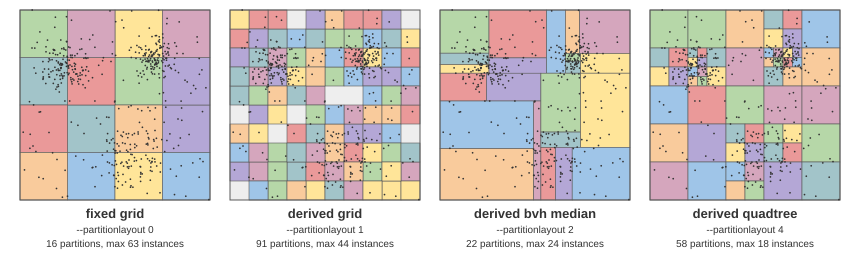

# Instance Partitions and the Partitioned TLAS for ray tracing cluster-based continuous level of detail

Scenes with millions of instances spend a noticeable part of the frame on work that scales with the instance count, even
when almost nothing changed since the last frame. The sample groups instances into spatial partitions and uses them
for two separate features:

* **The partition early-out** skips the per-instance kernels for partitions whose instances all sit on a persistent
  BLAS. It needs no extension and works with the regular TLAS.
* **The partitioned TLAS** (`VK_NV_partitioned_acceleration_structure`) replaces the full per-frame TLAS rebuild with
  an incremental one that only rewrites the instances whose BLAS changed.

The naming suggests the first is part of the second, but it is not: the early-out works on the plain TLAS path, and the
two compose.

Both are ray tracing only and configured in the UI under _"Traversal"_: _"Partitions"_ and _"Ptlas"_ directly, the
early-out and the layouts in the _"Partition settings"_ tree.

## Motivation

With [BLAS Caching](blas_caching.md) most instances of a large scene end up on a BLAS that persists over frames: the
geometry's cached BLAS, or its pre-built low detail BLAS. Their state does not change from one frame to the next, yet
every frame still classifies their LoD, decides their BLAS reuse, assigns their BLAS address and rebuilds the TLAS
over all of them.

Grouping the instances lets us detect cheaply that a whole group is unchanged and skip it. The partitioned TLAS is the
API equivalent for the acceleration structure: the driver keeps one structure per partition and only rebuilds the
partitions that received updates.

> [!NOTE]
> The partitioned TLAS is introduced in more detail by the
> [vk_partitioned_tlas](https://github.com/nvpro-samples/vk_partitioned_tlas) sample.

## Algorithm

### Partitions

`Scene::updatePartitions` assigns every instance a partition once on the host, and sorts the instance ids so that each
partition owns a contiguous range. Membership is fixed, only the scene or the layout settings change it. The
[layouts](#partition-layouts) are described further below.

### The early-out

The three kernels that run over every instance are `instance_classify_lod`, `traversal_init_blas_reuse` and
`instance_assign_blas`. The rule for skipping them is simple:

> A partition is _stable_ if **every** instance in it sits on a persistent BLAS. A single instance on a per-frame BLAS
> forces the whole partition.

`instance_assign_blas` counts the instances that ended up on a per-frame BLAS per partition, and the next frame
`partition_setup` reads that count with one thread per partition. A partition that is processed marks the blocks of
1024 sorted instances it covers, `partition_block_compact` compacts the marked blocks, and the three kernels are
dispatched indirectly over those blocks only.

Compacting blocks rather than instances keeps the per-frame work proportional to the blocks (thousands) instead of
the instances (millions). The price is granularity: a stable partition that shares a block with an active one is
dragged along.

### Revalidation

Skipping a stable partition defers quality, not correctness: an instance that came closer keeps its coarser
persistent BLAS until its partition is processed again. Two things bound that:

* `--partitionrevalidateframes` (64 by default) processes a stable partition at least every N frames.
* Partitions whose bounds cross a frustum plane, or that just entered the frustum, are processed every frame.
  Instances outside the frustum are classified coarser (`--cullederrorscale`), so without this an instance turning
  visible as the camera rotates would show its lower detail for up to the revalidation interval. Partitions touching the
  far plane are ignored, they stay coarse anyway.

### Cached BLAS lifetime

A skipped instance keeps pointing at whatever BLAS it had last. So a cached BLAS must neither be freed, nor lose the
clusters it was built from, while a partition that was not visited could still reference it.

> [!IMPORTANT]
> The streaming system therefore holds a replaced cached BLAS for longer than the revalidation interval, and refuses to
> unload the groups a live or held cached BLAS is built from. If a cached BLAS has to be freed early anyway, or
> streaming is reset, every partition is processed that frame. Without the early-out none of this is needed, all instances refresh every frame.

The refused unloads would make the retention permanent: a level that cannot lose a group never drops out of residency,
so the cached BLAS is never rebuilt coarser. `--blascacheretire` (on by default) breaks that loop. Once the age filter
asks for such a group, the cached BLAS steps down to the next coarser fully resident level, and the old one is held for
the usual interval before it and its clusters are released.

### The partitioned TLAS build

The scene is static here, so the global partition is not used and the full instance descriptions are written once at
init. Every frame `instance_assign_blas` compares the BLAS address of an instance with the last one it wrote, and only
emits an update for the instances whose BLAS changed, plus all instances on a per-frame BLAS or on a cached BLAS
rebuilt this frame, whose content changes even when the address repeats.

## Options

* _"Partitions"_ (`--partitions 1`, off by default) is the master switch. Without it neither of the other two is
  active and no partitions are built.
* _"Early out"_ (`--partitionearlyout 1`, on by default) skips stable partitions. It is off without BLAS
  sharing or caching, and depends on _"Blas Caching"_: without a cached BLAS hardly any partition ever becomes stable.
* _"Revalidate frames"_ (`--partitionrevalidateframes`, 64 by default) processes a stable partition at least every N
  frames. It also bounds how long a replaced cached BLAS is held, N + 4 frames.
* _"Revalidate frustum partitions"_ (`--partitionfrustumrevalidate 1`, on by default) processes the partitions crossing
  or entering the frustum every frame, up to _"Frustum distance"_ (`--partitionfrustumdistance`,
  0.25 by default) times the diagonal of the scene bounds.
* _"Retire cached blas"_ (`--blascacheretire 1`, on by default) lets a cached BLAS step down rather than hold its
  groups resident.
* _"Ptlas"_ (`--ptlas 1`, off by default) uses the partitioned TLAS, if the device supports the extension and the layout
  stays within its partition limit.
* _"Ptlas explicit bounds"_ (`--ptlasexplicitaabb 1`, off by default) provides the instance bounds to the partitioned
  TLAS rather than letting the driver derive them from the BLAS.

## Partition Layouts

How instances are grouped matters: the API is handed nothing but the partition count, so the grouping is the only
lever on the driver's top level structure. It affects the trace cost, the build cost and how often a partition can go
quiet as a whole.

_"Layout"_ (`--partitionlayout`) picks one of six variants. The UI only shows the settings the active layout uses.

### Fixed grid

`--partitionlayout 0`: uniform cells over the xz plane, ignoring y and the instance density.

* _"Grid cell size"_ (`--partitiongridcellsize`) sizes the cells in world units. They are aligned to the world origin
  rather than the scene bounds, so they do not move when the scene changes. _"Grid origin"_ (`--partitiongridorigin x y z`)
  shifts that origin, for example to keep a feature of the scene from being split by a cell border.
* Otherwise _"Grid cells per axis"_ (`--partitiongridcells`) splits the scene bounds into that many cells per axis.

Empty cells are dropped, so the partition count is the number of occupied cells.

### Derived grid

`--partitionlayout 1`, the default. The same xz grid, but the resolution is derived from the instance count:

* _"Derived target instances"_ (`--partitionderivedtarget`) sets the initial resolution,
  `ceil(sqrt(instances / target))` cells per axis.
* The resolution is doubled while a partition holds more than _"Derived max instances"_ (`--partitionderivedmax`),
* unless that would exceed _"Derived max count"_ (`--partitionderivedmaxcount`) partitions or, with the ptlas, the device limit.
  Doubling means the count can only approximate this budget.

### Derived BVH median and SAH

`--partitionlayout 2` and `3`: top-down splits of the instance set, derived from meshoptimizer's spatial clusterizer.
Each split picks the axis of widest extent. The median variant splits at the middle, rounded to a whole
_"Derived target instances"_, which gives uniform occupancy. The SAH variant picks the plane with an exact surface area
heuristic sweep over the instance bounds instead, trading occupancy for tighter partitions. Nodes split until they hold
no more than the target, and _"Derived max count"_ is spent on the fullest nodes first, so the bvh layouts hit it
exactly.

### Derived quadtree

`--partitionlayout 4`: starts from the derived grid's initial cells and splits each into quadrants while it holds more
than _"Derived target instances"_. Where the derived grid refines the whole scene to fit its densest cell, the quadtree
only refines the dense regions, and its cells stay aligned to the grid's. _"Derived max count"_ is spent on the fullest
nodes first, so with `--partitionderivedmaxcount 0` no partition holds more than the target, short of instances
at one spot or, with the ptlas, the device's partition limit.

### Node regex

`--partitionlayout 5`: the partitions come from the glTF node hierarchy rather than from a spatial heuristic. This is
meant for scenes whose authors already grouped things that belong together, for example a building or a block of a
city.

The nodes are selected at load time with `--partitionnodes "<regex>"`, a C++ regular expression matched against the
whole node name. All instances below a matching node share a partition, and a matching node nested inside another one starts
a new partition. Instances below no matching node share one more partition, and loading the scene logs a warning with
their count. With `--gridcopies` every copy gets its own set of partitions, the instances below no matching node
share one across all copies.

Without `--partitionnodes` this layout puts all instances into a single partition.

### Ordering

Downstream everything is indexed by partition, and the early-out compacts its work in blocks of neighbouring
partitions. The grid layouts therefore number their cells along a Z-order curve, the quadtree continues that curve
into its quadrants, and the bvh layouts number in depth-first order, so that partitions close in index are close in
space. The node regex layout keeps the order of the glTF nodes.

## Results and limitations

Measured on Caldera, 3 million instances of 37 thousand geometries, with the ray tracing renderer at 1600x1200 and
clocks locked, along a walking pace camera path. The configurations are interleaved within one process, 240 frames
each, three repetitions. Summing the trace, TLAS and traversal preparation timers:

| | sum (us) | Trace | TLAS Build | Traversal Prep |
| --- | --- | --- | --- | --- |
| no BLAS caching, no early-out | 3981 | 1245 | 1931 | 805 |
| BLAS caching and early-out | 3360 | 1263 | 1944 | 152 |
| plus partitioned TLAS | 1982 | 1447 | 416 | 119 |

The early-out removes most of the per-instance work without changing the rendering. The partitioned TLAS trades a
much cheaper build for a somewhat slower trace.

On this scene the derived grid was the fastest layout. Both bvh layouts lost 350-550 us of trace time to it, at the
same partition count. A balanced occupancy is clearly not what the trace cost tracks. Providing explicit instance
bounds to the partitioned TLAS saves another 50 us, about evenly from the build and the trace.

The early-out has a memory cost: a cached BLAS that a skipped partition may still reference has to keep its clusters
resident. With `--blascacheretire` residency comes close to running without the early-out, and converges to it once
the camera stands still.

`--visualize 12` colors the instances by partition, `--visualize 13` shows which partitions were processed in the
current frame (red) and which were skipped (green).

## Implementation

In the source look for `USE_PARTITION_EARLY_OUT` and `USE_PTLAS`.

Key changes are:

* [`scene_partitions.cpp`](../src/scene_partitions.cpp): the layouts and `Scene::updatePartitions`.
  `ScenePartitionConfig` in [`scene.hpp`](../src/scene.hpp) holds the settings.
* [`scene_gltf.cpp`](../src/scene_gltf.cpp): collects the node groups for the node regex layout while traversing the
  glTF nodes.
* [`partition_setup.comp.glsl`](../shaders/partition_setup.comp.glsl): one thread per partition decides whether it is
  skipped, including the frustum test, and marks the instance blocks of active ones.
* [`partition_block_compact.comp.glsl`](../shaders/partition_block_compact.comp.glsl): compacts the active blocks into
  an indirect dispatch.
* [`instance_classify_lod.comp.glsl`](../shaders/instance_classify_lod.comp.glsl),
  [`traversal_init_blas_reuse.comp.glsl`](../shaders/traversal_init_blas_reuse.comp.glsl) and
  [`instance_assign_blas.comp.glsl`](../shaders/instance_assign_blas.comp.glsl): the per-instance kernels the
  early-out skips. The last one also counts the per-frame BLAS of a partition and emits the instance updates of the
  partitioned TLAS.
* [`geometry_cached_retain.comp.glsl`](../shaders/geometry_cached_retain.comp.glsl): keeps the cached LoD level a
  geometry needs over a whole revalidation cycle, so the age filter does not unload groups that skipped instances
  still use.
* [`scene_streaming.cpp`](../src/scene_streaming.cpp): the deferred free, the unload pin and the retire of cached BLAS,
  look for `deferCachedBlasFree`, `blasCachePinGroups` and `appendCachedBlasRetires`.
* [`partitioned_acceleration_structures.hpp`](../src/partitioned_acceleration_structures.hpp): a small wrapper around
  the extension.
