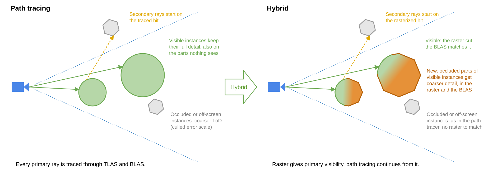

# Hybrid Rendering: rasterized primary visibility for path tracing cluster-based continuous level of detail

The hybrid renderer rasterizes primary visibility into a visibility buffer and path traces from there. Everything
after the primary hit stays the path tracer's: shadows, reflections, indirect bounces and the optical modes.



Select the _"Hybrid"_ renderer (`--renderer 3`). It builds on the ray tracing renderer's traversal, acceleration
structures and path tracer. The ray tracing pipeline and the ray query variant (_"Ray query"_, `--rayquery 1`) both
work, with ray queries being the faster one.

## Motivation

Path tracing traces a primary ray for every pixel, through a TLAS and BLAS that hold the whole LoD cut, including
geometry that ends up occluded. Rasterization gets the same primary hit from the mesh shader cluster pipeline, which
the sample already has, and can make use of occlusion culling, which ray tracing can only approximate.

* The primary trace is gone. The ray generation resolves the hit from the visibility buffer and continues the path.
* The LoD cut of a visible instance can be coarser where it is occluded, in the BLAS as well, because the raster
  defines what is visible.
* Texture LoD of the primary hit comes from the triangle's screen-space derivatives, as in rasterization. Both
  renderers take the primary sample at the pixel center plus the DLSS jitter.

The price is that two renderers now see the same geometry and have to agree on it.

## Algorithm

A frame runs the ray tracing renderer's traversal and acceleration structure builds, then the raster passes, then
the ray generation. Profiler timers are in quotes:

1. The traversal builds the LoD cut as for ray tracing. For instances in the frustum it also emits the clusters to
   rasterize, split by last frame's HiZ into a first pass list and a reject list.
2. CLAS, BLAS and TLAS (or PTLAS) builds as usual.
3. _"Draw"_: the first raster pass draws the list into the visibility buffer (`RG32UI`: instance id, and
   cluster id with the triangle index) and depth. A HiZ is built from it, the reject list is culled against that
   HiZ, and the second raster pass draws what became visible.
4. _"Trace"_: the ray generation reconstructs the primary hit from the visibility buffer and path traces from there.

### BLAS has to match the raster at primary visibility

Secondary rays start on the rasterized surface and hit the BLAS surface. Where the two differ, a surface shadows
or occludes itself. Raster defines primary visibility, so the BLAS follows the raster cut for visible instances:

* The raster never draws less detail than the instance's own LoD cut.
* _"Hybrid discrete LoD"_ (`--hybriddiscretelod 1`, default): an instance in the [BLAS caching](blas_caching.md) tail
  rasterizes a whole cached LoD level, the same way as [Discrete LoD](raster_discrete_lod.md), and uses that cached
  BLAS.
* _"Hybrid cached levels"_ (`--hybridcachinglevels 4`, default) keeps a chain of up to four cached levels per
  geometry instead of ray tracing's _"Cached levels"_ (`--cachinglevels`, 1 by default). The raster can then draw the instance's own level
  rather than the finest cached one. The chain refines by one level per geometry and frame.
* Otherwise the instance gets its own BLAS from the raster cut. An instance at the lowest detail uses the
  prebuilt low detail BLAS, which matches by construction.
* With `--hybriddiscretelod 0`, `--hybridcachedtolerance N` (off) lets a visible instance keep a cached BLAS within N
  levels of its cut instead, a known mismatch the match check counts separately. One level already shows dark self-shadowing blotches on the bunny
  grid under a grazing sun, also with a 64x larger `--shadowraymint`. They sit mostly inside the sun's shadow, so
  they do not come from the sun shadow ray.
* Visible instances are kept out of [BLAS sharing](blas_sharing.md) and [BLAS merging](blas_merging.md), whose BLAS
  come from another instance's or the finest resident cut.
* [BLAS deduplication](blas_dedup.md), _"Hybrid blas dedup"_ (`--hybridblasdedup 1`, on by default), is the reuse that
  stays exact for visible instances.
  Instances whose cuts resolve to the same clusters, for example copies that top or bottom out in the LoD DAG,
  build one BLAS. In the scenes below it removes 20 - 46% of the hybrid renderer's BLAS builds per frame (junkworld
  804 to 434, Zorah 930 to 740), up to 96 us of BLAS build time and 3.7 MiB of BLAS memory, for 5 - 8 us of its own.
  The path tracer finds next to no duplicates there. The results below ran without it.
* Instances that are off-screen or occluded get the same treatment as in the path tracer:
  LoD classification, BLAS sharing, merging and caching. Only secondary rays reach them, there is no raster to
  match. An occluded instance that reappears in the second raster pass may mismatch for that frame.

`--hybridmatchcheck 1` traces the primary ray as well and logs an error when more pixels disagree with the raster
than edge rounding explains. The error is logged with the next sequence step or `--memoryreportframes` report.

### Culling

With culling enabled the hybrid renderer always runs both raster passes. `--twopassculling` and
`--twopassrejectlists` configure the [Rasterization Two-Pass Culling](raster_twopass_culling.md) only.

* Partial occlusion is part of the LoD cut. Inside a visible instance, nodes and groups whose bounding sphere is outside
  last frame's frustum or fails its HiZ get the coarser culled error scale (`--cullederrorscale`), in the raster and in the BLAS.
  Occlusion is monotonic along the LoD hierarchy, a coarser sphere contains the finer ones, so the cut stays valid.
* The traversal splits the cut per cluster. What was visible in last frame's HiZ is drawn in the first pass,
  everything else goes to the reject list, which `render_hybridpath_cull.comp.glsl` tests against the new HiZ.
* The BLAS are built before the raster passes, so the second pass cannot change them. A disoccluded region, or one entering
  the view, therefore shows the culled detail for one frame, in the raster and the BLAS alike.
* `--primitiveculling 1` applies to both raster passes with `VK_NV_mesh_shader`, it was not faster in our tests.
* _"Allow SW-Raster"_ (`--swraster 1`, off by default) sends small opaque clusters of both passes to the compute
  rasterizer, below the same _"SW-Raster threshold"_ (`--swrasterthreshold 8`) as the raster renderer. It writes
  list index and depth with 64 bit atomics, a fullscreen pass merges them into the visibility buffer and depth
  before the hardware draw of the same pass. Alpha masked clusters stay on the hardware path. With the settings of
  the results below, _"Draw"_ took 60 us less on Zorah and 40 us more on junkworld.

### Other differences to the path tracer

* [Partition early-out](partitions_and_ptlas.md): partitions whose bounds intersect the frustum are always
  processed, as a skipped partition would emit no raster clusters. Partitions outside the frustum keep the
  early-out. Without `--culling` the early-out is off.
* [Hit-based streaming](hitbased_streaming.md) (`--hitstreaming 1`): the resolve registers the rasterized primary
  hit as the closest-hit shader does for a traced one. With `--hitstreaminglod`, visible instances follow the camera
  metric rather than the hit demand, there are no primary rays to demand their detail.
* Without `--culling` every instance in the frustum counts as visible: all of them are rasterized and none uses BLAS
  sharing or merging.
* `--cullminpixelsize` does not cull small instances, the BLAS keeps them and the raster has to match.
* Switching to or from the hybrid renderer resets streaming.
* The resolved primary hit, and the alpha test of rays that start at the camera, take texture LoD from the
  triangle's pixel derivatives. Secondary rays keep the ray cone.

## Results and limitations

Measured on an NVIDIA RTX PRO 5000 Blackwell with clocks locked, `--culling 1 --twopassculling 1`, 1 indirect bounce,
DLSS Ray Reconstruction rendering 2560x1440 for 3840x2160 output, ray queries (`--rayquery 1`) for all three renderers. The partitioned TLAS is on for Caldera
and junkworld, where it was faster, off for Zorah. The configurations are interleaved within one process, 96
frames each after 128 to settle, four repetitions. Frame times in microseconds:

| frame time in us | RT | PT | hybrid | hybrid - PT |
| --- | --- | --- | --- | --- |
| Caldera | 10152 | 13490 | 12294 | -1196 |
| junkworld | 9160 | 11468 | 11558 | +90 |
| Zorah | 9802 | 16151 | 17228 | +1077 |

RT is the _"Ray tracing"_ renderer with shadow and ambient occlusion rays, PT the _"Path tracing"_ renderer. DLSS Ray
Reconstruction is 5.8 ms of every frame. Share of the frame without it in percent for traversal (preparation and run)
/ acceleration structure builds (BLAS and TLAS) / _"Draw"_ and _"Trace"_, the rest is streaming and post-processing:

| traversal / builds / draw + trace in % | PT | hybrid |
| --- | --- | --- |
| Caldera | 2.7 / 8.8 / 86.3 | 6.2 / 10.5 / 80.6 |
| junkworld | 6.7 / 12.2 / 78.1 | 9.4 / 13.8 / 74.0 |
| Zorah | 2.3 / 5.0 / 91.1 | 3.5 / 8.5 / 86.4 |

Where the hybrid renderer differs from PT, in microseconds. PT has no _"Draw"_, so that column is the hybrid
raster plus the trace against PT's trace alone:

| hybrid - PT in us | Draw + Trace | Traversal | BLAS Build |
| --- | --- | --- | --- |
| Caldera | -1395 | +191 | -2 |
| junkworld | -166 | +162 | +71 |
| Zorah | +402 | +166 | +404 |

The raster costs 161 - 694 us, the trace gets 292 - 1555 us cheaper. That pays for the longer traversal on
Caldera, whose geometry is coarser overall and rasterizes cheaply. The smaller triangles of junkworld and Zorah
favor ray tracing the primary hit instead. On Zorah the primary rays are cheap, its dense geometry is expensive to
rasterize, and the visible instances build their own BLAS where PT shares or merges them.

With the ray tracing pipeline instead of ray queries the hybrid renderer saves less over PT, 252 us on Caldera.
When the bounce loop skipped `traceRayEXT` for the rasterized primary hit, every later trace got slower, for a
reason we did not find. So the loop still calls it there, with a cull mask that hits nothing. Ray queries need no
such workaround.

Memory as reported by the sample, RT and PT use the same, ray queries the same as the pipeline. Operations grow
as the per-frame build buffers are sized for one BLAS per instance, visible instances do not merge, and by the two
raster cluster lists:

| hybrid - RT, PT in MiB | Geometry | CLAS | BLAS | Operations | Render targets | Total |
| --- | --- | --- | --- | --- | --- | --- |
| Caldera | +46 | -2 | +3 | +88 | +30 | +165 (1845) |
| junkworld | +183 | -2 | +10 | +63 | +30 | +284 (1872) |
| Zorah | +611 | -52 | +21 | +6 | +30 | +616 (7241) |

Strengths:

* No primary trace. The trace is 0.3 - 1.6 ms faster than PT's, more where primary rays are expensive.
* Raster texture LoD for the primary hit.
* Occluded parts of visible instances get coarser detail in the BLAS too.
* With hit streaming, residency on Caldera and junkworld settles soon after the camera stops. PT keeps swapping
  groups.

Weaknesses:

* More memory, 0.16 - 0.6 GB in these scenes. Mostly the persistent vertex positions the raster needs, on Caldera
  the build buffers sized per instance, and 30 MiB for the visibility buffer. The coarser occluded
  detail saves some CLAS memory.
* The traversal also emits the raster's cluster lists (+160 - +190 us), the raster itself costs 0.16 - 0.7 ms.
* Visible instances cannot use BLAS sharing or merging. Scenes with many visible instances of the same geometry
  build more BLAS, `--hybridblasdedup` only wins back those with identical cuts.
* The partition early-out processes every partition in the frustum, 1.7 - 2.7 times as many as PT.
* Disoccluded regions and regions entering the view show coarser detail for one frame.

The views as `--camerastring`, the scene's clip planes unchanged:

```
Caldera   "{366.9366948140463, 15.5753170790398, 1298.4168259129406}, {1855.7385927806326, -67.63717141502805, 883.2545715043068}, {0, 1, 0}, {60}"
junkworld "{859.35, 40.67, -752.48}, {936.92, 11.66, -886.90}, {0, 1, 0}, {60}"
Zorah     "{7.729438781716869, 2.278317616701172, -11.146185904338534}, {-0.48448207571498436, 4.16349113944963, -8.020231954707505}, {0, 1, 0}, {60}"
```

## Implementation

In the source look for `USE_HYBRIDPATH` and `m_hybrid`.

* [`render_hybridpath_raster.frag.glsl`](../shaders/render_hybridpath_raster.frag.glsl): writes the visibility buffer,
  the mesh shaders are the rasterization ones with `USE_HYBRIDPATH`.
* [`render_hybridpath_cull.comp.glsl`](../shaders/render_hybridpath_cull.comp.glsl): tests the reject list against
  the HiZ of the first pass, for the second pass.
* [`render_hybridpath_raster_atomic.frag.glsl`](../shaders/render_hybridpath_raster_atomic.frag.glsl): merges what
  [`render_raster_clusters_sw.comp.glsl`](../shaders/render_raster_clusters_sw.comp.glsl) rasterized into the
  visibility buffer.
* [`render_hybridpath_hit.glsl`](../shaders/render_hybridpath_hit.glsl): resolves the primary hit from the
  visibility buffer.
* [`render_pathtrace_raygen.glsl`](../shaders/render_pathtrace_raygen.glsl): the path tracer's ray generation, with
  `USE_HYBRIDPATH` its primary hit comes from the visibility buffer. Included by
  [`render_hybridpath.rgen.glsl`](../shaders/render_hybridpath.rgen.glsl) and, for ray queries,
  [`render_pathtrace_rq.comp.glsl`](../shaders/render_pathtrace_rq.comp.glsl).
* [`instance_classify_lod.comp.glsl`](../shaders/instance_classify_lod.comp.glsl): keeps visible instances out of the
  BLAS sharing and merging elections.
* [`traversal_init_blas_reuse.comp.glsl`](../shaders/traversal_init_blas_reuse.comp.glsl): picks the BLAS of a visible
  instance, its own cut or a cached level, and seeds the hybrid discrete LoD.
* [`renderer_hybrid_clusters_lod.cpp`](../src/renderer_hybrid_clusters_lod.cpp): `RendererHybridClustersLod` derives
  from the ray tracing renderer and records the two raster passes, the HiZ and the cull.
